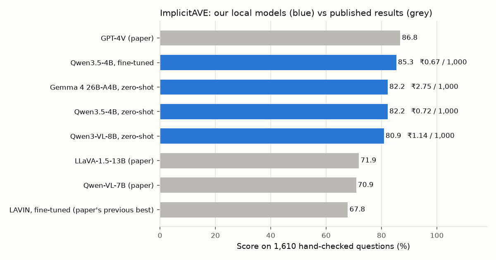
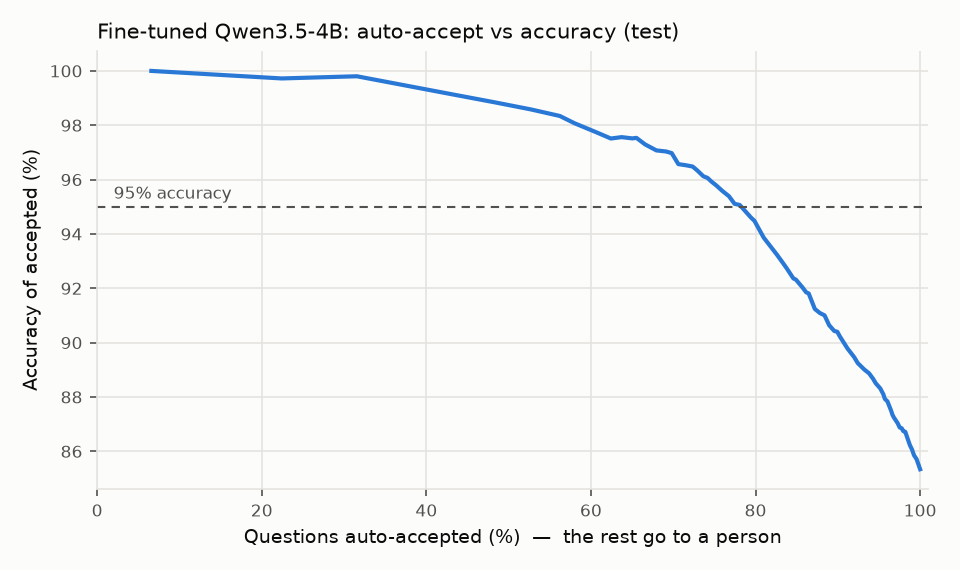

# Visual Product Tagging

**Tagging product attributes from photos with a small open model, at GPT-4V level.**

*Sisir Kausthubh*

A 4-billion-parameter vision-language model, fine-tuned in 48 minutes on one laptop GPU,
tags products from their photos (sleeve style, neckline, heel height, material, pattern…)
with **85.3% accuracy on a hand-checked public benchmark: 1.4 points from GPT-4V, and
17.5 points above the best fine-tuned model in the benchmark paper.** It costs about
**₹0.67 per 1,000 products**, runs fully on local hardware, and flags the answers it isn't
sure about.

## Highlights

- **GPT-4V-level accuracy from a 4B open model:** 85.3% vs GPT-4V's 86.8% on all 1,610
  hand-checked questions.
- **Ahead of GPT-4V in 2 of 5 domains:** Clothing (**88.0 vs 77.4**, the benchmark's hardest
  domain) and Jewelry & accessories (92.3 vs 90.5).
- **+17.5 points (+26% relative) over the best fine-tuned model in the paper** (LAVIN, 67.8).
- **More accurate than a 26B model, at a quarter of the cost:** the fine-tuned 4B beats
  Gemma 4 26B-A4B (85.3 vs 82.2) at ₹0.67 vs ₹2.75 per 1,000.
- **Knows when it's unsure:** 79% of products are tagged automatically at 94.6% accuracy;
  the other 21% are flagged for review. The cut-off was set on validation data, then
  checked on test.
- **Fast and cheap to train:** LoRA fine-tune in 48 min, 9.7 GB peak GPU memory; serves 24
  questions per second with vLLM.



Online catalogues need attributes like "neckline" or "boot style" to power search filters,
but sellers often leave them out. The value usually isn't written in the title. It has to
be *inferred* from the photo, which is why a vision model is needed.

## Results

Benchmark: [ImplicitAVE](https://github.com/HenryPengZou/ImplicitAVE) (Zou et al., ACL
Findings 2024). It has 1,610 test questions across 5 domains, and every answer was
**checked by hand** by the dataset's authors. Each question gives one photo, the title, the
attribute and its allowed values. The score is the % answered correctly, which equals the
paper's micro-F1. Comparison rows are the results reported in that paper (Table 4).

| Setup | Clothing | Footwear | Jewelry&GA | Food | Home | **All** | ₹ / 1,000 |
|---|---|---|---|---|---|---|---|
| **Qwen3.5-4B, fine-tuned (this project)** | **88.0** | 78.9 | **92.3** | 89.0 | 82.1 | **85.3** | **0.67** |
| Qwen3.5-4B, zero-shot | 83.2 | 74.5 | 90.5 | 86.2 | 79.9 | 82.2 | 0.72 |
| Gemma 4 26B-A4B, zero-shot | 82.7 | 69.4 | 93.6 | 86.4 | 81.8 | 82.2 | 2.75 |
| Qwen3-VL-8B, zero-shot | 80.1 | 72.6 | 90.0 | 84.1 | 79.9 | 80.9 | 1.14 |
| GPT-4V (paper) | 77.4 | 81.4 | 90.5 | 90.8 | 89.9 | 86.8 | paid API |
| LLaVA-1.5-13B (paper) | 49.1 | 63.7 | 81.8 | 76.2 | 80.3 | 71.9 | – |
| Qwen-VL-7B (paper) | 59.7 | 57.7 | 84.1 | 76.9 | 74.0 | 70.9 | – |
| LAVIN, fine-tuned (paper's best fine-tuned) | 65.9 | 75.4 | 78.6 | 60.8 | 64.3 | 67.8 | – |

### What this project adds beyond the benchmark paper

| | Benchmark paper | This project |
|---|---|---|
| Accuracy of the best open / fine-tuned model | 71.9 / 67.8 | **85.3** |
| Cost per 1,000 products | not reported | **measured for every model** |
| Confidence on each answer | no | **yes** |
| Auto-tag vs human review | no | **yes: 79% automatic at 94.6%** |
| Runs locally on open weights | best result needs a paid API | **yes: Apache-2.0 models, vLLM** |
| Small vs large model trade-off | not studied | **studied: fine-tuned 4B beats 26B** |

### Auto-accept or send to a person

Each answer has a confidence score: the model's probability for the value it chose. Keep
confident answers automatically and flag the rest. The cut-off for each target was chosen
on separate validation questions, then applied unchanged to the test set:

| Target accuracy | Auto-accepted (test) | Accuracy of accepted (test) |
|---|---|---|
| 90% | 90% | 90.2% |
| 95% | **79%** | **94.6%** |
| 98% | 62% | 97.5% |

So about **4 in 5 attributes can be filled automatically at ~95% accuracy**, and a person
checks only the remaining 1 in 5.



### What didn't work: sending hard cases to the bigger model

I also tested a cascade: when the small model is unsure, ask Gemma 4 26B instead. With the
cut-off chosen on validation, the cascade scores **85.3%, no better than the fine-tuned
small model alone**, and costs more (₹0.99 vs ₹0.67 per 1,000). After fine-tuning, the 4B
model is simply better than the 26B one on this task, so a bigger model is only worth it as
a *different* model (the two get different questions wrong: if you always picked the right
one you would get 90.9%). Choosing the cut-off on the test set would have shown 85.9%, but
that would be tuning on the test, so it isn't reported. Details:
[reports/implicitave/results.md](reports/implicitave/results.md).

### Caveats

- The paper's numbers come from 2023 models. Ours are 2026 models, so part of the gain is
  newer models, not only fine-tuning. The zero-shot rows show how much: 82.2 → 85.3 from
  fine-tuning.
- Training labels are ImplicitAVE's own machine-made labels (from MAVE), as in the paper.
  Only the test set is hand-checked. Validation labels were used only to choose cut-offs.
- Cost = GPU time measured on an RTX 5090 laptop GPU (batches of 32) × an assumed rental
  price of $0.60/hour, at ₹95.46/$. Change `PRICE_USD_PER_HOUR` in
  [analyze.py](scripts/implicitave/analyze.py) to re-price.
- The models may have seen these Amazon products during pre-training. That can't be ruled
  out for any of the models compared.

## How it works

1. **Question.** For each test row: the photo, the title, the attribute and its allowed
   values ([implicitave.py](src/catalog_cascade/implicitave.py)).
2. **Constrained answer.** vLLM serves the model; a JSON schema forces the answer to be
   one of the allowed values, so it can't make one up. Thinking mode is off.
3. **Confidence.** The probability of the chosen value's tokens, from the returned
   log-probs. The JSON around the value is forced by the schema, so it carries no signal.
4. **Fine-tuning.** LoRA (rank 16) on Qwen3.5-4B's language layers with the vision layers
   frozen, using Unsloth. At most 150 examples per answer value, so common values don't
   drown out rare ones ([train.py](scripts/implicitave/train.py)). The adapter is merged
   into 16-bit weights for serving.
5. **Analysis.** Scores, cost, cascade and auto-accept, with every cut-off chosen on
   validation data ([analyze.py](scripts/implicitave/analyze.py)).

## Reproduce (Ubuntu, one 24 GB NVIDIA GPU, ~1.5 hours)

```bash
# environments: .venv-serve (vLLM 0.32), .venv-train (Unsloth), .venv-api (analysis)
bash scripts/stage1/setup_envs.sh

# data: the authors' repo (test set and photos) and their training photos (Google Drive)
git clone https://github.com/HenryPengZou/ImplicitAVE data/raw/implicitave/repo
# training photos: download the 3 archives from the link in
# data/raw/implicitave/repo/data/training_data/images/README.md and unpack them into
# data/raw/implicitave/train_images/

bash scripts/implicitave/zero_shot.sh                      # 3 models zero-shot, ~10 min
.venv-train/bin/python scripts/implicitave/train.py        # fine-tune, ~50 min
bash scripts/implicitave/zero_shot.sh outputs/iave-qwen35-4b-merged qwen35_4b_finetuned
bash scripts/implicitave/zero_shot.sh outputs/iave-qwen35-4b-merged val_qwen35_4b_finetuned --split val --limit 2000
bash scripts/implicitave/zero_shot.sh cyankiwi/gemma-4-26B-A4B-it-AWQ-4bit val_gemma4_26b_zeroshot --split val --limit 2000
.venv-api/bin/python scripts/implicitave/analyze.py        # tables and charts
```

On a machine without the CUDA toolkit, the scripts set `VLLM_USE_FLASHINFER_SAMPLER=0`
(see [docs/stage1.md](docs/stage1.md)).

## Repository

| Path | What |
|---|---|
| `src/catalog_cascade/implicitave.py` | Loading, the question, the answer schema |
| `scripts/implicitave/` | Prediction, fine-tuning, analysis |
| `reports/implicitave/` | Every model's answers, results tables, charts, training log |
| `docs/earlier_abo_work.md` | The project's first direction (Amazon Berkeley Objects), set aside |

## Credits and licences

ImplicitAVE: Zou et al., *ImplicitAVE: An Open-Source Dataset and Multimodal LLMs Benchmark
for Implicit Attribute Value Extraction*, ACL Findings 2024
([arXiv 2404.15592](https://arxiv.org/abs/2404.15592)). The dataset isn't redistributed
here. Models: Qwen3.5-4B, Qwen3-VL-8B (Apache-2.0), Gemma 4 26B-A4B (community AWQ build,
Apache-2.0). Code: MIT. See [DATA_LICENSES.md](DATA_LICENSES.md).
